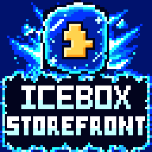

<p align="center">
  
</p>

<p align="center">
  <a href="README.md">English</a> · <b>Русский</b>
</p>

# IceBoxStorefront Plugin — релиз 1.0.1

**Интеграция Steamworks для IceBoxEngine.** Windows · Linux · macOS.

Плагин предоставляет Lua API `Storefront` — 194 функции, и все они доступны ещё и как ноды визуального
скриптинга: достижения, статистика, таблицы лидеров, Steam Cloud, друзья, Rich Presence, оверлей, лобби,
P2P-сеть, голосовой чат, Мастерская (UGC), DLC, билеты аутентификации, Steam Timeline и запись игры, а также
поддержка Steam Input / Steam Deck / Steam Machine / Steam Frame.

> **Бесплатный, но не open source.** Плагин распространяется как **скомпилированная библиотека** вместе с
> манифестом, каталогом нод и документацией. Исходного кода нет ни в этом репозитории, ни в архиве релиза, и он
> нигде не публикуется. Пользоваться плагином можно бесплатно, в том числе в коммерческих играх, — см. раздел
> [«Лицензия»](#лицензия).

> **Это не продукт Valve.** Плагин разрабатывает IceBoxCrew Studio, и он **не создан Valve Corporation, не
> аффилирован с ней, не одобрен и не спонсируется ею**. **Steamworks SDK в комплект не входит** — вы сами
> скачиваете его у Valve на условиях её собственного соглашения
> [Steamworks SDK Access Agreement](https://partner.steamgames.com/doc/sdk).

## Где скачать

Скачайте архив релиза под **вашу платформу, вашу архитектуру и вашу версию движка** со страницы
[Releases](https://github.com/IceBoxCrew/IceBoxStorefront/releases) или с itch.io. В этом репозитории лежит
всё, что нужно папке плагина, *кроме* скомпилированной библиотеки: манифест, каталог нод, иконка, документация
и юридические тексты. Так что клон репозитория — это папка плагина, которой не хватает всего одного файла.

## Установка

**1 — Распакуйте в `Plugins/`.** В архиве уже лежит папка с именем `IceBoxStorefront`, поэтому достаточно
распаковать его в `Plugins/` движка (тогда плагин доступен всем проектам) или в `Plugins/` проекта (только
этому проекту) — и папка окажется ровно там, где ей место. **Не переименовывайте папку**: движок опознаёт
плагин по этому имени.

**2 — Добавьте рантайм Valve.** Скачайте Steamworks SDK с
[partner.steamgames.com/doc/sdk](https://partner.steamgames.com/doc/sdk) и скопируйте из него **один файл** в
папку плагина, рядом с `IceBoxStorefront.dll` / `IceBoxStorefront.so` / `IceBoxStorefront.dylib`:

| Платформа | Файл | Откуда |
| --- | --- | --- |
| Windows x64 | `steam_api64.dll` | `redistributable_bin/win64/` |
| Windows x86 | `steam_api.dll` | `redistributable_bin/` |
| Linux x64 | `libsteam_api.so` | `redistributable_bin/linux64/` |
| Linux x86 | `libsteam_api.so` | `redistributable_bin/linux32/` |
| Linux arm64 | `libsteam_api.so` | `redistributable_bin/linuxarm64/` |
| macOS arm64 | `libsteam_api.dylib` | `redistributable_bin/osx/` |
| macOS x64 | `libsteam_api.dylib` | `redistributable_bin/osx/` |

Берите файл той же архитектуры, что и распакованный архив. На macOS это один универсальный
`libsteam_api.dylib` и для архива arm64, и для архива x64. Сборки под Windows ARM64 нет: Valve не выпускает
рантайм Steam для Windows на ARM64.

Папка плагина — единственное место, с которым согласны все три динамических загрузчика: на Windows плагин
загружает рантайм оттуда явно, на Linux плагин несёт RPATH `$ORIGIN`, а на macOS `libsteam_api.dylib` собран с
install name `@loader_path/libsteam_api.dylib` и *обязан* лежать рядом с библиотекой, которая его линкует.
Движок выбирает библиотеку плагина по имени, поэтому рантайм в той же папке никогда не будет принят за сам
плагин.

**3 — Настройте AppId.** Создайте `steam_config.json` рядом с `plugin.json`:

```json
{
    "AppId": 480,
    "RestartIfNecessary": true
}
```

| Ключ | По умолчанию | Значение |
| --- | --- | --- |
| `AppId` | — | Ваш Steam AppId. `480` — публичное тестовое приложение Spacewar от Valve. |
| `RestartIfNecessary` | `true` | Перезапускать выпущенную игру через Steam, если её запустили напрямую. Выставьте `false` для DRM-free-сборки той же игры или если вы используете DRM-обёртку Valve. |

`ICEBOX_STEAM_APPID` переопределяет AppId, а `ICEBOX_STEAM_NO_RESTART=1` пропускает проверку перезапуска для
одного запуска. Во время разработки держите рядом с собранной игрой `steam_appid.txt` с тем же числом — и
удалите его из релиза.

**4 — Включите плагин.** В редакторе: **Tools → Plugins & Mods**, отметьте **IceBoxStorefront**. В Lua
появится таблица `Storefront`, а в редакторе визуальных скриптов — ноды. Больше ничего настраивать не нужно.

## Документация

| | |
| --- | --- |
| Русский справочник API | [`Documentation/RU/Storefront-LuaAPI-RU.md`](Documentation/RU/Storefront-LuaAPI-RU.md) |
| English API reference | [`Documentation/EN/Storefront-LuaAPI-EN.md`](Documentation/EN/Storefront-LuaAPI-EN.md) |
| Выпуск вашей игры | [`DISTRIBUTION.md`](DISTRIBUTION.md#как-выпускать-игру-с-этим-плагином) |
| Лицензия | [`LICENSE.txt`](LICENSE.txt) |
| Юридическая сводка | [`NOTICE.md`](NOTICE.md) |
| Уведомления третьих сторон | [`THIRD_PARTY_NOTICES.txt`](THIRD_PARTY_NOTICES.txt) |

Справочник описывает каждую функцию, перечисление, колбэк и возвращаемую таблицу — с сигнатурами, таблицами
параметров и готовыми к запуску примерами. Это полное описание API: исходников у вас нет, и они вам не нужны.
Когда папка плагина на месте, справочник показывает и редактор: в **Help → Documentation** оба справочника
перечислены под **IceBoxStorefront**, рядом с руководствами по движку.

```lua
if Storefront.IsAvailable() then
    Storefront.UnlockAchievement("ACH_FIRST_WIN")
    Storefront.SetRichPresence({ statusText = "На арене" })
end
```

Когда активного бэкенда нет, каждый вызов — безопасная пустая операция, поэтому один и тот же скрипт без
изменений работает на платформах без Steam. Если нужно ветвление, проверяйте `Storefront.IsAvailable()`.

## Что лежит в папке плагина

- `IceBoxStorefront.dll` / `IceBoxStorefront.so` / `IceBoxStorefront.dylib` — сам плагин, из архива релиза.
  **Обязателен.**
- `plugin.json` — манифест. Движок опознаёт плагин по его полю `Name`, а оно равно `IceBoxStorefront`.
  **Обязателен.**
- `VisualScriptAPI.json` — каталог нод. Редактор загружает его из папки плагина, показывает все функции
  `Storefront` как ноды и подсказывает их в автодополнении редактора Lua. Он выглядит сгенерированным, и он
  такой и есть, но это **обязательный файл данных времени выполнения**: билд без него молча теряет все ноды
  `Storefront`.
- `icon.png` — иконка плагина 256×256, которую показывают панель Plugins в редакторе и вкладка Plugins & Mods
  в лаунчере. Уберёте её — плагин будет пустой плиткой.
- `Documentation/` — полный справочник по API, около 400 КБ Markdown. Редактор читает его для своей панели
  Documentation; в сборку игры эта папка не попадает.
- `LICENSE.txt`, `NOTICE.md`, `THIRD_PARTY_NOTICES.txt` — держите их в папке. Именно
  `THIRD_PARTY_NOTICES.txt` закрывает требования атрибуции sol2, Lua, nlohmann/json и fmt.

## Версии движка

Плагин линкует **ту же Lua, что и движок**, поэтому каждая сборка привязана к версии движка. В каждом релизе
указано, под какую версию он собран; обновили движок — возьмите соответствующую сборку плагина.

Если версии всё же разошлись, плагин **отказывается регистрировать таблицу `Storefront`** и пишет в лог строку
`[Steam] Lua ABI mismatch`, а не роняет редактор с ошибкой access violation. Видите эту строку — скачайте
релиз, собранный под вашу версию движка.

## Выпуск вашей игры

Вот в чём легко ошибиться, причём ошибка ничем себя не выдаёт. Полный список — в
[`DISTRIBUTION.md`](DISTRIBUTION.md#как-выпускать-игру-с-этим-плагином):

- **Включите плагин в `Config/Plugins.json`.** Движок находит все папки плагинов, но загружает только те, что
  перечислены там как включённые. Когда вы отмечаете **IceBoxStorefront** в редакторе, этот файл записывается,
  а **Tools → Build Game** его копирует. Без этого ваша игра увезёт плагин и никогда его не загрузит.
- **Не отгружайте `steam_appid.txt`.** Он велит Steam пропустить проверку запуска — это правильно на вашей
  машине во время тестов и неправильно в релизе. А вот `steam_config.json` *уезжает* с игрой: именно из него
  игра читает свой AppId.
- **Оставьте рантайм Steam в папке плагина.** Распространять его *вместе с вашей игрой* вам разрешает
  Раздел 1.1 вашего собственного Steamworks SDK Access Agreement.
- **`Documentation/` в игру не попадает.** Это данные только для редактора, поэтому **Tools → Build Game** сам
  оставляет её за бортом игры.
- **Редактор тоже инициализирует Steam.** С рабочим AppId запуск редактора отмечает вас в Steam как играющего
  в эту игру и позволяет разблокировать настоящие достижения из режима Play. Это сделано намеренно — так вы и
  тестируете, — но, когда Steam вам не нужен, используйте AppId `480` или отключайте плагин.

## Ранний старт

Плагин экспортирует функцию `IcePluginEarlyBoot`, которую **рантайм игры** (но никогда не редактор) вызывает
до старта движка. Она определяет AppId и выполняет `SteamAPI_RestartAppIfNecessary`, так что даже игрок,
запустивший исполняемый файл напрямую, в итоге всё равно играет под Steam — с работающими оверлеем, облаком и
достижениями. Вызывать из Lua ничего не нужно.

## Ноды визуального скриптинга

Каждая функция `Storefront`, `Storefront.Workshop`, `Storefront.Input` и `Storefront.Timeline` доступна как
нода — с выпадающими списками перечислений, типизированными пинами (возвращаемые таблицы — это именованные
типы вроде `Table<UserHandle>`, а списки выходят массивами, готовыми для **For Each**), несколькими выходными
пинами, чистыми нодами-геттерами и пинами колбэков типа `Function`. Редактор подхватывает
`VisualScriptAPI.json` сам — устанавливать и настраивать ничего не нужно, — а редакторы Lua-скриптов
используют тот же файл для автодополнения. Подробности — в разделе «Ноды визуального скриптинга»
документации.

Нода **Tick** не нужна: пока работает рантайм, плагин сам каждый кадр доставляет результаты и колбэки событий.
Нода **Tick** (категория *Steam Events*) остаётся доступной как необязательный явный сброс очереди.

## Лицензия

© 2026 IceBoxCrew Studio. Все права защищены. См. [`LICENSE.txt`](LICENSE.txt).

**Бесплатно, навсегда, в том числе для коммерческих игр** — ни роялти, ни платы за проект, ни обязательных
упоминаний. Скомпилированный плагин уезжает внутри игры, которую вы выпускаете для игроков; иначе нельзя — без
него игра не запустится.

**Не open source.** Исходный код не поставляется и нигде не публикуется. Не перезаливайте плагин отдельно от
своей игры — на другой сайт, в маркетплейс, в пак ассетов, в чужой SDK — и не занимайтесь его обратной
разработкой. Если плагин нужен коллеге, дайте ссылку на страницу загрузки: это бесплатно и займёт минуту.

**Steamworks SDK не входит в этот пакет** и никогда не входил. Получите его у Valve на условиях
*Steamworks SDK Access Agreement*, которое Valve заключает непосредственно с вами. IceBoxCrew Studio не
является стороной этого соглашения и ничего по нему не сублицензирует. Никогда не помещайте файл из этого SDK
ни во что, что вы передаёте другому разработчику.

Steam, Steamworks, Steam Deck, Steam Machine, Steam Frame, Steam Cloud, Steam Workshop, Steam Input, Big
Picture и Proton — товарные знаки и/или зарегистрированные товарные знаки **Valve Corporation** в США и/или
других странах, используемые здесь исключительно описательно. Логотипов и графики Valve в комплекте нет.
**Этот плагин не создан Valve Corporation, не аффилирован с ней, не одобрен и не спонсируется ею.**

Плагин скомпилирован с использованием sol2, Lua, nlohmann/json и, опционально, fmt — см.
[`THIRD_PARTY_NOTICES.txt`](THIRD_PARTY_NOTICES.txt). Для использования плагина нужна ваша собственная
лицензионная копия IceBoxEngine.

<sub>Ничто здесь не является юридической консультацией.</sub>
